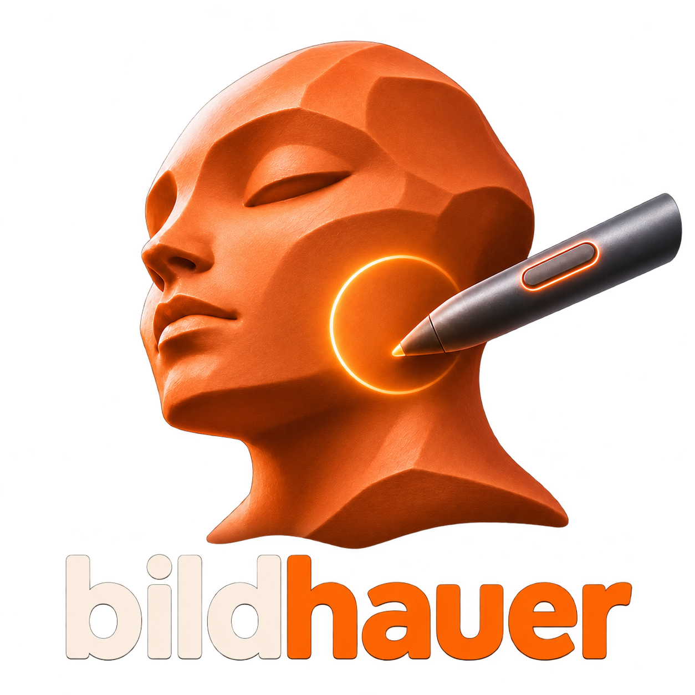

  

# bildhauer

**bildhauer is a remake of Sculptris**, the free digital sculpting program
that many artists started with. It runs on Windows and on Android tablets and
phones. On Android you can sculpt with a pen or with your fingers.

## Why

Sculptris was loved because it was simple: you push and pull a ball of
virtual clay, and the program adds detail wherever you sculpt. No polygon
counts, no topology, no setup. Then Pixologic bought it and stopped working
on it. Today it is hard to find, no longer maintained, and it may stop
running on future systems.

We think a tool like that should exist and stay free. bildhauer brings
Sculptris back as independent, open software that nobody can buy and shut
down.

## What you can do with it

- **Sculpt like with clay.** Draw, Smooth, Grab, Inflate, Flatten, Pinch,
  Crease, Rotate, Scale, Mask and Reduce, the brushes you know from
  Sculptris. Detail is added only where you work, so you never have to think
  about the mesh.
- **Work symmetrically.** Like in Sculptris, a new model starts with
  symmetry on, and a thin line shows the middle. Switch it off for details
  that differ left and right.
- **Pick a material** to sculpt with: red wax like in Sculptris, clay,
  white, gold, jade or slate.
- **Jump to a view** with the axes in the top right corner: front, back,
  left, right, top or bottom.
- **Shape your strokes with brush masks** (stencil images).
- **Paint your model:** color, bump detail and material layers with matcaps
  (clay, gold and your own images).
- **Open and save Sculptris files (.sc1).** Your old Sculptris models open
  in bildhauer, and files saved by bildhauer open in Sculptris.
- **Export as OBJ** (File > Export OBJ) to keep working on your model in
  Blender, ZBrush, Maya or any other 3D program.
- **Sculpt on the go** on an Android tablet or phone, with a pen or just your
  fingers.

## Who it is for

- Beginners who want to try digital sculpting without learning a big program
- Artists who want to rough out a character or an idea quickly
- Everyone who misses Sculptris

## Controls on Windows

| | |
|---|---|
| Left mouse | sculpt / paint |
| Ctrl | invert the brush |
| Shift | smooth |
| Right mouse or Alt + left | turn the view |
| Middle mouse | move the view |
| Wheel | zoom |
| `[` `]` | brush size (with Ctrl: strength) |
| Ctrl+Z | undo |

The status bar always shows the keys for the current brush. All shortcuts:
Help > Mouse and keys.

**With a pen tablet** (Wacom, Cintiq, Surface Pen and others), pressing
harder makes the stroke stronger, both when sculpting and when painting.
"Pen pressure" in the brush panel switches this off. With a Wacom tablet,
"Use Windows Ink" must be on in the Wacom Tablet Properties (it is on by
default).

Note: as in Sculptris, switching to paint mode is one way. Once you paint,
the shape of the model is fixed, so save a copy first if you want to keep
sculpting it.

## On Android tablets and phones

bildhauer runs on Android tablets and phones. You need no pen: your fingers
work as well. It was tested on a Samsung Galaxy Tab S3 with S Pen and on a
Google Pixel 7 Pro.

### Sculpting with touch or a pen

- **Finger on the model:** sculpt.
- **Finger next to the model:** turn the view. Add a second finger to move
  and zoom. The second finger can land anywhere, but the first one must start
  next to the model.
- **Pen on the model:** sculpt. Pressing harder makes the brush stronger.
- **Pen next to the model:** turn the view.

While the pen touches the screen or hovers over it, fingers do nothing, so
your hand can rest on the glass. If the model fills the whole screen, Frame
brings it back.

### On a tablet

- The tools are on the left. Size, strength and the other settings are in
  the bar at the top. Tap the small tab under the bar to fold it away and
  get more room.
- Undo, Frame and Wireframe are at the bottom. Open, Save and OBJ export are
  in the menu at the top right.

### On a phone

Hold the phone sideways. The model gets the whole screen.

- The current tool, Undo, Frame and Wireframe are on the left. Tap the tool
  to see all tools with large icons.
- Size, Strength and Invert are on the right, always at hand.
- Tap the tab at the top for the other settings: Detail, symmetry, the
  material, the tool's options and the menu with Open, Save and OBJ export.
- Tap next to an open panel to close it.

The Android version is a test version. It does not paint yet.

## Download

Both versions are on the
[Releases](https://github.com/Farbfinsternis/bildhauer/releases) page.

- **Windows** (10 and 11, 64 bit): download the ZIP, unpack it anywhere and
  start `bildhauer.exe`. Nothing needs to be installed.
- **Android** (9 or newer, 64 bit): download the APK on the tablet or phone
  and open it. Android asks once whether you allow apps from this source.

Developers find how to build it in [DEVELOPMENT.md](DEVELOPMENT.md).

## License

Free and open under the [MIT License](LICENSE): use it, share it, change it.

Sculptris is a trademark of its owners. bildhauer is an independent project,
not affiliated with Pixologic or Maxon, and contains none of their files.
